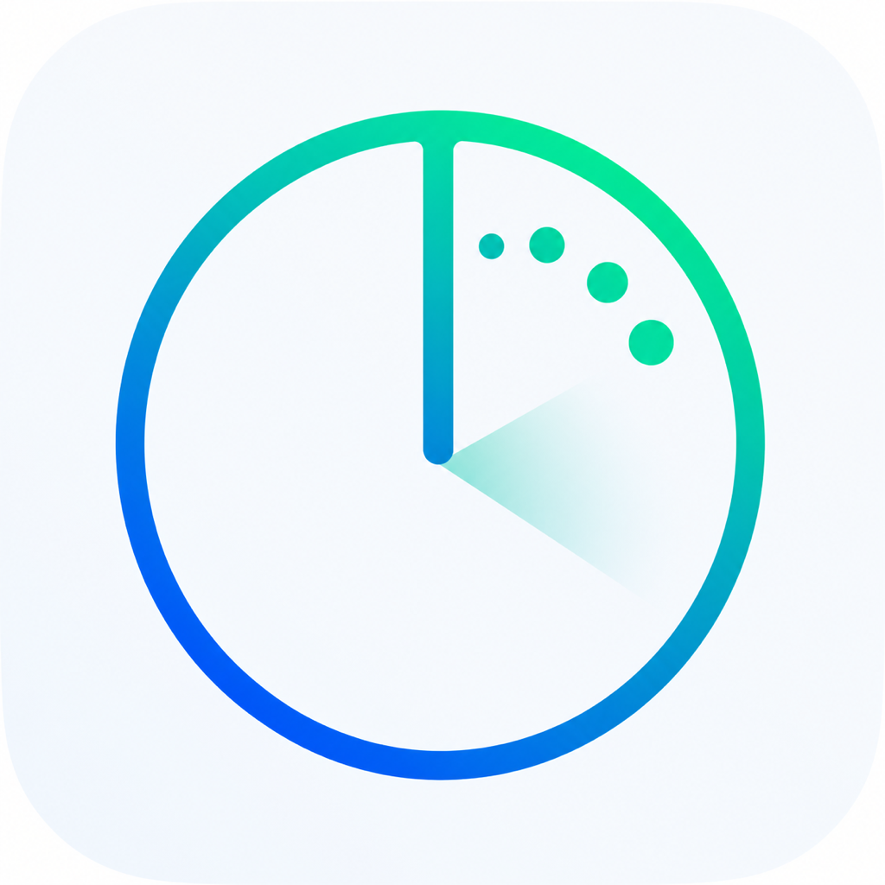

# Opportunity Radar

<p align="center"></p>

[](https://github.com/hadronic-arvind/opportunity-radar/actions/workflows/ci.yml)
[](LICENSE)

Opportunity Radar is a private search and application workspace for jobs, internships, apprenticeships, fellowships, grants, research programs, and events.
It collects public listings, lets you explore across organizations and fields, and helps you review fit and requirements before saving an opportunity.

It runs in short bursts and exits after each scan.
Nothing polls in the background, and no local web server is opened.
Every core search, profile, source, and tracking operation is available through the CLI.
The setup and operation instructions below are for the copyright holder and anyone who has received prior written permission under the [proprietary license](LICENSE).

## Quick start

Requirements are Python 3.9 or newer on macOS or another Unix-like system.
The scanner has no third-party Python dependencies.
Building the optional macOS app also requires the Apple Command Line Tools (`xcode-select --install`).

```bash
git clone https://github.com/hadronic-arvind/opportunity-radar.git
cd opportunity-radar
python3 -m monitor init
python3 -m monitor scan --progress
./scripts/open_dashboard.sh
```

`init` creates private configuration from your opportunity types, desired roles, subjects, and locations.
Accept automatic coverage to start across industries, or choose a named preset or manual packs.
Use `python3 -m monitor init --non-interactive --opportunity-types hackathon,grant --domains "climate science"` for a terminal-only setup.
Automatic coverage is the default and searches supported employers across industries, then matches individual jobs to your profile.
Your roles, fields, skills, career stage, and opportunity types also add specialist sources.
Choosing a named field preset also seeds practical role, domain, and skill targets that remain editable.
Skip it to use the neutral starter profile and five diverse structured feeds.

## Choose an interface

The CLI works immediately and installs no app.
Set `OPPORTUNITY_RADAR_CLI_ONLY=1` to skip automatic HTML generation while keeping search, profiles, source management, and tracking available.

```bash
./scripts/open_dashboard.sh
python3 -m monitor scan
```

On macOS, the native app is optional.
It opens the dashboard directly and enables named profiles, profile editing, Refresh, Scan all, Save, and application-status controls.

```bash
./scripts/install_launch_agent.sh
python3 extras/macos-app/install.py
```

The schedule and app are independent, so you can omit either one.

Add `--desktop-shortcut` only if you want an icon on the Desktop.

```bash
python3 extras/macos-app/install.py --desktop-shortcut
```

Cloning the repository never creates an app or Desktop icon by itself.

## Daily use

The macOS scheduler checks due sources at 07:30 and 16:30 local time, then exits.
Open Opportunity Radar whenever you want to review the latest dashboard.
Use Refresh for due sources or Scan all when you deliberately want to ignore source cadences.

Run `python3 -m monitor scan --progress` to check due sources and see what remains.
A regular scan stops starting sources after 45 seconds of collection, finishes the in-flight source, and publishes the results so far.
Repeat it to continue through due sources, add `--source SOURCE_ID` to focus on a specific source, or add `--force` for a deliberate full refresh.
`./scripts/open_dashboard.sh` opens the last local snapshot immediately.

- **Discover** shows profile matches and lets you search the wider collection, including listings outside your configured fit.
- **Tracker** keeps saved, planned, applied, and dismissed items available when their source or profile fit changes.
- **Coverage** shows which sources are enabled, what the last run checked, and which directories are available for manual exploration.

Open a listing to review source passages, known dates, availability, and profile checks.
An ambiguous requirement stays visible for review.
The native app and CLI update the same SQLite tracker.
A standalone browser keeps its convenience actions in local browser storage.

Your profile can be changed at any time from the native app or the CLI.

```bash
python3 -m monitor profile show
python3 -m monitor profile set \
  --timeframe "Summer 2028" \
  --include "scientific computing,machine learning" \
  --opportunity-types "internship,research_program" \
  --coverage-preset automatic
python3 -m monitor profile validate
```

Profile changes immediately rescore the existing dashboard without a network request.
Every later due or forced scan reads the latest saved profile.
If a scan is already running, the app keeps the profile editor available and applies one saved update immediately afterward, so the active scan finishes with its original snapshot and the next scan uses the new profile.
The app keeps personal goals on Basics, searchable source packs on Sources, and scoring, matching rules, and document routing on Advanced.
Removing a basic role or domain retires obsolete positive advanced rules tied only to the removed target, while retained cross-domain, negative, qualification, and hard-gate rules stay intact.

Create a complete named profile in one shot from versioned JSON, including JSON drafted from a resume by an AI model.

```bash
python3 -m monitor profile template > my-profile.json
python3 -m monitor profile import --file my-profile.json --dry-run
python3 -m monitor profile import --file my-profile.json
```

The app offers the same flow through **Import JSON**.
Location choices use an embedded offline city, state, and country hierarchy, so selecting a country also matches listings that name only a city in that country.
Degree entry separates normalized degree level from a suggested field of study.
Enrollment restrictions distinguish undergraduate, master's, and doctoral candidates without treating a minimum degree as a maximum.
The optional citizenship filter supports multiple citizenships, permanent residency, and U.S. national status; incomplete requirements remain flagged for review.
See [Configuration](docs/CONFIGURATION.md#one-shot-profile-import) for the complete format.

Save separate profiles for different people, disciplines, career stages, or search strategies, then activate the one that should control sources and matching.

```bash
python3 -m monitor profile list
python3 -m monitor profile create "Clinical research"
python3 -m monitor profile duplicate "Clinical research" "Public health"
python3 -m monitor profile activate "Public health"
python3 -m monitor profile rename "Public health" "Epidemiology"
python3 -m monitor profile delete "Clinical research"
```

Activating a profile atomically changes its matching preferences and source packs, rescores existing opportunities, and rebuilds the dashboard.
Bookmarks and application status remain shared, so switching profiles never loses workflow history.

Fit scores are deterministic triage from your rules.
They are not acceptance probabilities.
When your profile names specific interests, broad words such as Fellowship or Research do not establish subject fit by themselves.
A human-rights fellowship can be a strong match for a legal profile while staying outside a technical research profile.
Generic academic titles are evaluated with your chosen fields, and explicit medical residency requirements are checked against declared student qualifications.
Saved opportunities and applications remain accessible when your profile changes.

## Sources and customization

The public catalog spans technology, finance, retail, logistics, media, healthcare, manufacturing, energy, science, education, public interest, and other fields.
Automatic and named coverage use shared employer feeds across industries and may add relevant multi-employer or specialist sources.
A healthcare company can have accounting jobs, and an aerospace company can have legal or software jobs: employer industry never excludes a company from this shared set.
Each job is matched using its own title, department, description, requirements, and your preferences.
The unconfigured five-source starter stays small; choose Manual coverage to use only selected packs, or explicitly disable individual sources.
Broader coverage fills in across successive refreshes, with source cadence and a bounded collection window.
Structured public pages and RSS or Atom feeds can supply opportunities outside employment, including academic programs and events.
An item falling out of a rolling feed remains unconfirmed.
After 90 days without seeing it again, a successful refresh archives it locally while preserving any tracker state.
See [Cross-industry source coverage](docs/SOURCE_COVERAGE.md) for the design, additions, and verification details.
Named presets add bounded target suggestions as well as sources, which gives a new profile useful matches before the user learns the advanced scoring controls.
Large official directories remain available in the dashboard resource library without being fetched automatically.

```bash
python3 -m monitor sources packs
python3 -m monitor sources list
python3 -m monitor sources discover "research fellowship"
python3 -m monitor sources health
python3 -m monitor sources test figma_greenhouse
python3 -m monitor sources add \
  --name "Example Robotics" \
  --url "https://jobs.ashbyhq.com/example"
```

Hosted Greenhouse, Lever, and Ashby URLs are recognized automatically.
Other public pages are checked for structured listing data, then for bounded same-site links.
Use `--kind syndication` for an RSS or Atom feed, `--kind json_ld` for structured page data, or `--kind watch_page` to monitor a directory for changes.
New sources are live-tested before saving by default and are written atomically to the private registry.
Use `sources show`, `enable`, `disable`, and `remove` to manage them later.

The CLI can also search, inspect, and export stored opportunities without opening the dashboard.

```bash
python3 -m monitor opportunities list --matched --available
python3 -m monitor opportunities search "technical writer" --location "Montréal" --unique
python3 -m monitor opportunities search "robotics" --type hackathon --sort deadline --json
python3 -m monitor opportunities list --saved
python3 -m monitor opportunities list --status apply --include-inactive --csv
python3 -m monitor opportunities show OPPORTUNITY_ID
python3 -m monitor bookmark OPPORTUNITY_ID true
python3 -m monitor status OPPORTUNITY_ID apply
```

CLI search reads the full committed collection while a scan is running.
The dashboard carries bounded search summaries and detailed review data for a smaller set.
Use `opportunities show` for the complete stored listing and its evidence.

The app and CLI write personal settings to one canonical private location.
Before scheduler installation that location is the clone, and afterward it is the installed private runtime.
These ignored files hold the data:

- `config/profiles.local.json` for named profiles, the active profile, matching preferences, source-pack choices, and private source additions.
- `config/profile.local.json` and `config/sources.local.json` as preserved legacy migration inputs and recovery backups when they already exist.

See [Configuration](docs/CONFIGURATION.md) for the schema and examples.
Official source names in the dashboard are clickable, including manual resources that do not expose a structured listing feed.

## Privacy and permissions

Opportunity Radar performs read-only requests to configured public HTTPS sources.
Applications open on the original provider's site.
Profiles, fit assessments, and tracking activity stay on the device.
Change alerts use local macOS notifications.

The generated dashboard, SQLite database, local configuration, logs, seeds, and scheduler files are excluded from Git and use owner-only permissions.
The dashboard is a self-contained local file with a strict content-security policy and no remote scripts or assets.
The native app exposes only a validated local action bridge and opens listing links in the default browser.

The scheduler stores its private runtime under `~/Library/Application Support/OpportunityRadar`.
The optional app is installed under `~/Applications`.
Desktop access is needed only when you explicitly request a Desktop shortcut or keep the clone there.

Read [Security](SECURITY.md) for the trust model and vulnerability reporting process.

## Maintenance

```bash
./scripts/doctor.sh
./scripts/uninstall_launch_agent.sh
```

After pulling code changes, upgrade the scheduler first if installed, then rebuild the optional native app:

```bash
./scripts/install_launch_agent.sh
python3 extras/macos-app/install.py
```

Quit and reopen the app to load the upgrade.
The upgrade preserves saved profiles, bookmarks, and application status.
Profile and source-pack changes made through the app or CLI do not require reinstallation.
Uninstalling the scheduler leaves the database and dashboard intact.

Contributors can use the separate [Developer guide](docs/DEVELOPMENT.md) for optional tooling, code navigation, and validation.
These tools are not required to install or use the app.
See [Operations](docs/OPERATIONS.md) for runtime maintenance and [Repository participation](CONTRIBUTING.md) for contribution terms.

Opportunity Radar is publicly viewable but proprietary software.
All rights are reserved under the [license and copyright notice](LICENSE).

## Profile coverage audit

Nine anonymous [example profiles](examples/profiles/README.md) cover medicine, business, biomedical engineering, accounting, teaching, law, design, skilled trades, and an international PhD student.
The [coverage audit](docs/AUDIENCE_AUDIT.md) records live-source findings, known gaps, and the sandbox rerun command.
